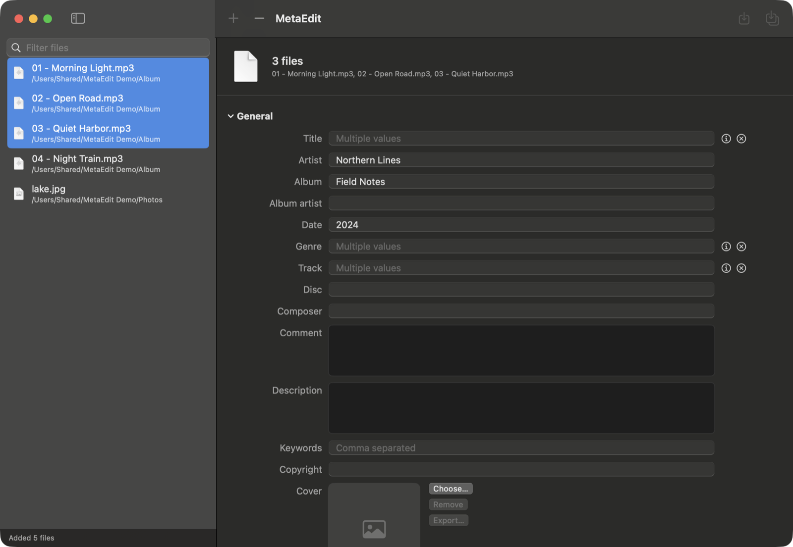

# MetaEdit — бесплатный редактор метаданных и тегов для Mac

MetaEdit меняет метаданные почти любых файлов на macOS: теги MP3, FLAC и M4A вместе с обложками, EXIF, IPTC
и XMP у фотографий, теги видео, теги и комментарии Finder. Можно править один файл или сразу целую папку.
Файлы не перекодируются, меняются только теги.

[**Скачать для macOS**](https://github.com/j-tap/meta-edit/releases/latest) · macOS 14+, Apple Silicon и Intel · [English](README.md)



## Возможности

- Музыка, фото, видео и всё остальное в одном окне. У неизвестных форматов можно менять имя, даты, теги
  и комментарий Finder.
- Пакетное редактирование: выделите альбом и задайте исполнителя, жанр или обложку всем трекам сразу. Если
  значения у файлов разные, в поле написано «Multiple values», и можно выбрать одно из них для всех.
- Перед сохранением нескольких файлов видно, что и в скольких файлах изменится. «Only where empty» заполняет
  только пустые поля.
- Видны и редактируются все теги файла, а не только основные поля.
- Незнакомые теги, данные камеры и цветовые профили сохраняются.
- Обложки: замена, удаление, экспорт.
- Может сохранять исходную дату изменения файла.
- Нативное приложение на Swift, около 5 МБ.

Звук, видео и картинка копируются байт в байт. Тесты сравнивают декодированный звук и пиксели до и после
каждой записи.

## Форматы

| Тип | Форматы | Поля |
|---|---|---|
| Аудио | MP3, FLAC, OGG Vorbis, Opus, M4A (AAC, ALAC), WAV, AIFF, APE, WavPack, Musepack, WMA, DSF, DFF | название, исполнитель, альбом, исполнитель альбома, год, жанр, номер трека и диска, композитор, комментарий, текст песни, BPM, ISRC, обложка, любой тег ID3v2 / Vorbis / MP4 / APE / ASF |
| Видео | MP4, M4V, MKV, WebM | название, автор, описание, комментарий, жанр, обложка и другие |
| Фото | JPEG, PNG, TIFF, HEIC, AVIF, GIF, JPEG 2000, PSD; WebP и RAW только чтение | название, автор, описание, ключевые слова, копирайт, рейтинг, заголовок, город, страна, метка, любой XMP-тег; EXIF отображается |
| Любой файл | — | имя, теги Finder с цветами, комментарий Finder, «Откуда загружено», даты создания и изменения |

В планах: PDF и офисные документы, [ExifTool](https://exiftool.org) для RAW, MOV и редких форматов, версии
для Windows и Linux.

## Установка

Скачайте `.dmg` из [релизов](https://github.com/j-tap/meta-edit/releases/latest) и перетащите MetaEdit
в «Программы».

Приложение пока не заверено Apple, поэтому первый запуск macOS заблокирует. Разрешите его в **Системные
настройки → Конфиденциальность и безопасность → Всё равно открыть** или выполните:

```
xattr -dr com.apple.quarantine /Applications/MetaEdit.app
```

## Как пользоваться

Перетащите файлы или папки в окно (или ⌘O), выделите один или несколько (⇧⌘A — все), поменяйте поля
и нажмите ⌘S. ⇧⌘S сохраняет все изменённые файлы, они отмечены оранжевой точкой.

## Аналоги

Mp3tag, Kid3 и MusicBrainz Picard для музыки, ExifTool и его оболочки для фото, платный Media Meta. MetaEdit
работает со всеми этими типами файлов в одной бесплатной программе.

## Сборка

```
git clone https://github.com/j-tap/meta-edit.git
cd meta-edit
brew install cmake
make macos        # apps/macos/dist/MetaEdit.app
make test-macos
```

Достаточно Command Line Tools, полный Xcode не нужен. Подробнее в [apps/macos/README.md](apps/macos/README.md),
[архитектура](docs/architecture.md), [поля метаданных](docs/metadata-schema.md) и
[правила пакетного редактирования](docs/batch-editing.md).

Ошибки и пожелания по форматам — в [Issues](https://github.com/j-tap/meta-edit/issues).

## Лицензия

[MIT](LICENSE)
